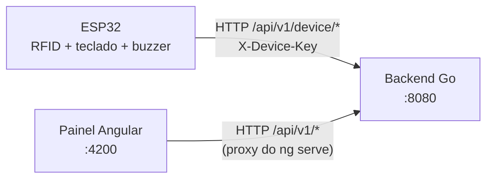
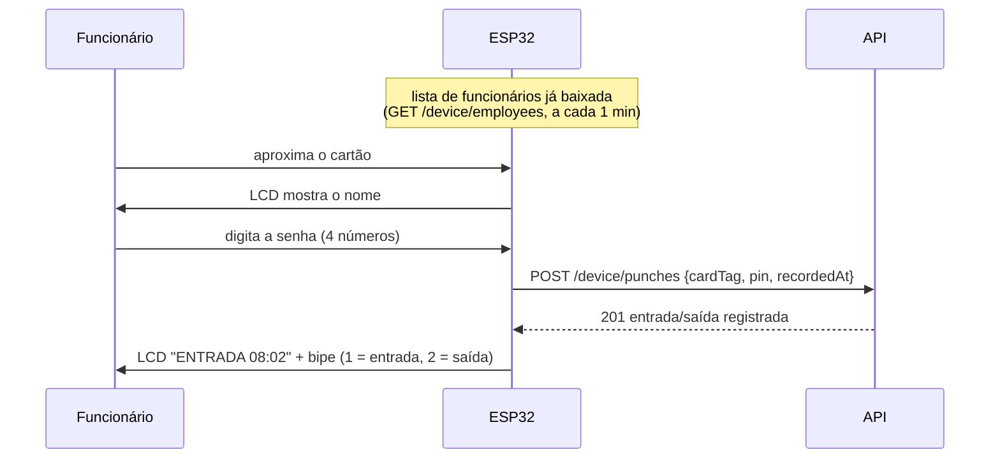
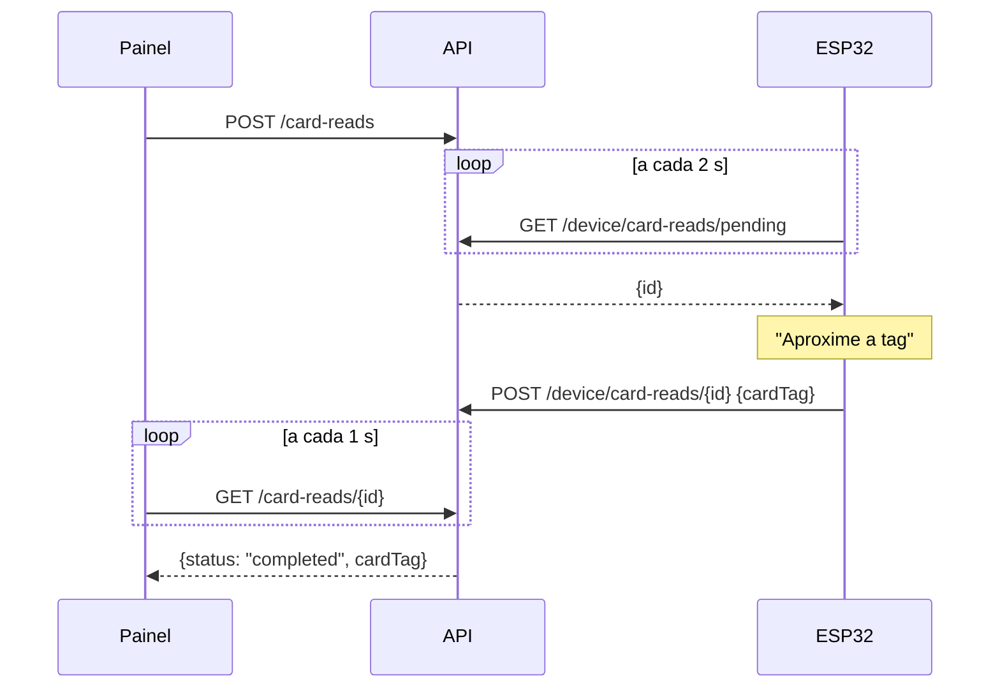

# Ponto Eletrônico

Relógio de ponto com **ESP32 + RFID + teclado**, **API em Go** e **painel web em Angular**.

O funcionário aproxima o cartão do relógio, digita a senha de 4 números e o ponto vai para o backend. O painel mostra quem está presente, calcula horas trabalhadas, atrasos e horas extras, permite corrigir marcações e exportar relatórios.



## Sumário

- [Estrutura do projeto](#estrutura-do-projeto)
- [Rodando o projeto](#rodando-o-projeto)
- [Como funciona](#como-funciona)
- [Referência da API](#referência-da-api)
- [ESP32](#esp32)
- [Desenvolvimento](#desenvolvimento)
- [Limitações e próximos passos](#limitações-e-próximos-passos)

## Estrutura do projeto

```
backend/                  API em Go (biblioteca padrão + go-pdf/fpdf para o PDF)
  cmd/api/                main.go (rotas) e seed.go (dados de demonstração)
  cmd/relogio-virtual/    simulador do ESP32 no terminal
  config/                 variáveis de ambiente
  handler/                camada HTTP: lê a requisição, chama o service, escreve JSON
  middleware/             log, CORS e autenticação do dispositivo
  model/                  structs que viram JSON
  report/                 geração do espelho de ponto em PDF
  repository/             interfaces + SQLite (banco) e versão em memória (testes)
  service/                regras de negócio (e os testes)
frontend/                 painel em Angular 22 (zoneless, signals)
  src/app/core/           models.ts, services HTTP, formatação
  src/app/components/     card-read-button ("Ler no relógio")
  src/app/pages/          dashboard, employees, register-employees, time-records
  proxy.conf.json         encaminha /api para localhost:8080 no ng serve
esp32/                    firmware do relógio
  src/                    código do ESP32, dividido em módulos (veja [ESP32](#esp32))
  platformio.ini          build com PlatformIO
  diagram.json            circuito para o Wokwi
  wokwi.toml              simulação no Wokwi para VS Code
  libraries.txt           bibliotecas para o wokwi.com
```

## Rodando o projeto

### Jeito rápido: `dev.sh`

Na raiz do projeto:

```bash
./dev.sh
```

Esse comando instala as dependências do frontend se faltar, sobe o backend (com dados de demonstração) e o frontend juntos e mostra os logs dos dois com prefixo `[backend]`/`[frontend]`. Abra `http://localhost:4200`. **Ctrl+C** para os dois.

| Comando | O que faz |
|---------|-----------|
| `./dev.sh` | backend + frontend |
| `./dev.sh backend` | só o backend |
| `./dev.sh frontend` | só o frontend |
| `./dev.sh relogio` | relógio de ponto virtual no terminal (simula o ESP32) |
| `./dev.sh test` | testes do backend e do frontend |
| `./dev.sh esp32` | compila o firmware (`upload` grava, `monitor` abre o serial) |
| `./dev.sh punch [TAG] [PIN]` | bate um ponto de teste sem ESP32 (padrão `A1:B2:C3:D4 1234`) |
| `SEED_DEMO_DATA=false ./dev.sh` | não cria os dados de exemplo (para zerar o banco, apague `backend/ponto.db`) |

Os passos abaixo mostram como rodar cada parte manualmente.

### Pré-requisitos

| Parte    | Precisa de |
|----------|------------|
| Backend  | Go 1.22+ |
| Frontend | Node 20+ e npm |
| ESP32    | [PlatformIO](https://platformio.org/) (CLI ou extensão do VS Code) e, para simular, a extensão [Wokwi for VS Code](https://docs.wokwi.com/vscode/getting-started) |

### 1. Backend

```bash
cd backend
SEED_DEMO_DATA=true go run ./cmd/api
```

Sobe em `http://localhost:8080`. Com `SEED_DEMO_DATA=true` o servidor já começa com 3 funcionários e algumas batidas (veja [dados de demonstração](#dados-de-demonstração)).

Teste rápido: `curl localhost:8080/api/v1/health` → `{"status":"ok"}`

#### Banco de dados

Os dados ficam num banco **SQLite**, que é um arquivo só: `ponto.db`, criado na pasta de onde o backend é executado (com `dev.sh`, fica em `backend/ponto.db`). O log mostra o caminho completo ao iniciar (`database: ...`).

- **Não precisa instalar nada.** O driver ([modernc.org/sqlite](https://pkg.go.dev/modernc.org/sqlite)) é escrito em Go puro e vai dentro do executável; não precisa de SQLite, gcc nem CGO.
- As tabelas são criadas sozinhas na primeira execução.
- **Backup:** pare o backend e copie o `ponto.db`. Para restaurar, coloque o arquivo de volta.
- **Começar do zero:** pare o backend e apague o `ponto.db`.
- Para abrir e consultar as tabelas, use qualquer visualizador de SQLite (por exemplo o [DB Browser for SQLite](https://sqlitebrowser.org/)). As datas ficam em UTC (`2026-11-12T11:02:00.000000000Z` = 08:02 em Brasília).
- Pedidos de "Ler no relógio" continuam só em memória: duram no máximo 60 s e não precisam ser guardados.

Para gerar um executável e levar para o PC que vai rodar o sistema (o PC não precisa ter Go):

```bash
cd backend
CGO_ENABLED=0 GOOS=windows GOARCH=amd64 go build -o ponto.exe ./cmd/api   # Windows
CGO_ENABLED=0 go build -o ponto ./cmd/api                                 # Linux
```

Ao abrir o `ponto.exe`, o `ponto.db` é criado na mesma pasta.

#### Variáveis de ambiente

| Variável | Padrão | Para que serve |
|----------|--------|----------------|
| `PORT` | `8080` | Porta HTTP |
| `DEVICE_API_KEY` | `dev-device-key` | Chave que o ESP32 envia no header `X-Device-Key`. **Troque em produção** e configure a mesma chave no relógio (`chave` no `config.txt` do SD ou no monitor serial). |
| `CORS_ALLOWED_ORIGINS` | `http://localhost:4200` | Origens liberadas, separadas por vírgula. `*` libera todas. Só importa se o front não usar o proxy. |
| `APP_TIMEZONE` | `America/Sao_Paulo` | Fuso usado para separar os dias e calcular horários |
| `SEED_DEMO_DATA` | `false` | `true` cria dados de exemplo ao iniciar (só se o banco estiver vazio) |
| `DB_PATH` | `ponto.db` | Arquivo do banco SQLite. Pode ser um caminho completo, ex.: `C:\Ponto\ponto.db`. A pasta é criada se não existir. |

### 2. Frontend

```bash
cd frontend
npm install
npm start
```

Abra `http://localhost:4200`. O `ng serve` usa o `proxy.conf.json` para mandar tudo que começa com `/api` para `localhost:8080`, então não precisa configurar URL nem CORS em desenvolvimento.

### 3. ESP32 (ou simulação)

Não precisa de ESP32 de verdade para testar. Existem duas formas de simular:

| | Relógio virtual | Wokwi |
|---|---|---|
| O que é | programa no terminal que faz o papel do ESP32 | simulador que roda o **firmware real** do ESP32 |
| Precisa de | só Go | PlatformIO + extensão Wokwi no VS Code + conta Wokwi (grátis) |
| Bom para | desenvolver o painel e o backend | testar mudanças no firmware (`esp32/src/`) |

#### Opção A: relógio virtual (mais simples)

Em um terminal suba o sistema e em outro abra o relógio:

```bash
./dev.sh            # terminal 1: backend + painel
./dev.sh relogio    # terminal 2: relógio virtual
```

No relógio, digite a tag e depois a senha:

```
Aproxime o cartao (digite a tag): A1:B2:C3:D4
Ola, Ana Souza!

Senha (4 numeros): 1234
********** PONTO REGISTRADO **********
  Ana Souza - ENTRADA as 08:01 (batida 1 do dia)
**************************************
```

O comando `lista` mostra as tags cadastradas. O relógio virtual também atende o botão **Ler no relógio** do painel: quando você clica nele, o relógio pede a tag e envia para o formulário. Ele usa exatamente as mesmas rotas `/device/*` do ESP32 (código em `backend/cmd/relogio-virtual/`).

#### Opção B: Wokwi (firmware de verdade)

Uma vez só:

1. Instale o PlatformIO: extensão **PlatformIO IDE** no VS Code ou, pelo terminal, `pip install platformio`. O `dev.sh` também acha o PlatformIO instalado em `~/.platformio`.
2. Instale a extensão **Wokwi for VS Code** (`wokwi.wokwi-vscode`).
3. No VS Code: **F1 → "Wokwi: Request a New License"**. Abre o navegador para entrar na conta Wokwi (grátis) e ativa a licença.

Para rodar:

1. `./dev.sh` em um terminal (backend + painel).
2. `./dev.sh esp32` para compilar o firmware. A primeira vez demora porque baixa o compilador do ESP32.
3. No VS Code: **F1 → "Wokwi: Select Config File"** → escolha `esp32/wokwi.toml` (só na primeira vez).
4. **F1 → "Wokwi: Start Simulator"**. Abre o circuito com o ESP32, teclado, LCD, RTC, cartão SD e buzzer (o RTC do Wokwi é um DS1307, compatível com o código do DS3231 para ler e acertar a hora).
5. No monitor serial que aparece embaixo, simule o cartão (o Wokwi não tem leitor RFID):
   ```
   tag A1:B2:C3:D4
   ```
   e clique `1`, `2`, `3`, `4` no teclado do circuito (ou digite `pin 1234` no serial).

Depois de alterar o firmware, rode `./dev.sh esp32` de novo e reinicie o simulador.

No Wokwi para VS Code o endereço `host.wokwi.internal` aponta para o seu computador; é o que já está configurado em `API_URL_PADRAO` (`esp32/src/config.h`).

> No **wokwi.com** (navegador) a simulação não alcança o seu `localhost`. Nesse caso exponha o backend com um túnel (ex.: `ngrok http 8080`) e troque `API_URL_PADRAO` pela URL gerada.

#### Gravando em um ESP32 de verdade

Não precisa mexer no código: Wi-Fi, servidor e chave são configurados depois de gravar, pelo **cartão SD** (`config.txt`) ou pelo monitor serial, e ficam salvos no ESP32 (sobrevivem a desligar e regravar).

**1. Preparar o computador (uma vez)**

- Instale o PlatformIO (veja a Opção B acima).
- No Linux, dê permissão na porta USB: `sudo usermod -aG uucp $USER` (Arch) ou `sudo usermod -aG dialout $USER` (Ubuntu/Debian). Depois saia e entre de novo na sessão.
- Se o ESP32 não aparecer, pode faltar o driver do chip USB da placa (CP210x ou CH340). No Linux eles já vêm no kernel; no Windows instale o driver do fabricante.

**2. Montar o circuito** conforme a [pinagem](#pinagem).

**3. Gravar**

Ligue o ESP32 no USB e rode:

```bash
./dev.sh esp32 upload     # compila e grava
./dev.sh esp32 monitor    # abre o monitor serial (Ctrl+C sai)
```

Se aparecer `Connecting....` e não sair disso, segure o botão **BOOT** da placa até começar a gravar.

**4. Conectar no Wi-Fi e no servidor**

O ESP32 entra na rede Wi-Fi como um celular faria e conversa com o PC do backend **pela rede local**. Não precisa de internet; ela só serve para acertar a hora por NTP (sem ela, a hora vem do PC e do RTC).

O backend precisa estar rodando em um computador **na mesma rede** do ESP32. Descubra o IP desse computador (`ip -4 addr` no Linux, `ipconfig` no Windows), por exemplo `192.168.0.10`, e **fixe esse IP no roteador** (reserva de DHCP). Se o IP do PC mudar, o relógio para de achar o servidor.

**Jeito fácil: `config.txt` no cartão SD.** Ligue o relógio uma vez com o cartão: ele cria `config-exemplo.txt`. No PC, copie como `config.txt`, preencha e devolva o cartão:

```
wifi_ssid=MinhaRede
wifi_senha=SenhaDaRede
servidor=http://192.168.0.10:8080/api/v1
chave=dev-device-key
```

O arquivo é lido sempre que o relógio liga e o que estiver nele vale por cima do que estava salvo. Campo vazio não muda nada (exceto `wifi_senha`, que vazio significa rede sem senha). O arquivo fica com a senha do Wi-Fi em texto: se preferir, apague-o depois do primeiro uso, porque a configuração continua salva no ESP32.

**Pelo monitor serial**, se não tiver cartão SD:

```
wifi
Nome da rede (SSID): MinhaRede
Senha (vazio se a rede for aberta): ********
Conectando ao Wi-Fi "MinhaRede"...
Wi-Fi conectado. IP: 192.168.0.42

servidor http://192.168.0.10:8080/api/v1
Servidor salvo: http://192.168.0.10:8080/api/v1
...
Servidor: online
```

Se o backend usa outra `DEVICE_API_KEY`, rode também `chave SUA_CHAVE`. Pronto: aproxime um cartão cadastrado.

**Se não conectar**

| Sintoma no `status` | Causa provável |
|---------------------|----------------|
| `Wi-Fi: desconectado` | senha errada, ou a rede é só 5 GHz (o ESP32 só funciona em **2.4 GHz**) |
| `Servidor: offline (servidor indisponivel)` | IP errado, backend parado ou firewall bloqueando a porta 8080 |
| `Servidor: offline (X-Device-Key invalido)` | chave diferente da do backend, use `chave ...`. As batidas ficam na fila até lá |
| `Tag nao cadastrada` | cadastre a tag no painel, usando o botão **Ler no relógio** |
| `Leitor RFID: NAO ENCONTRADO` | fios do MFRC522 (SDA=D5, RST=D27) ou falta de 3.3 V. Se só falha com o SD encaixado, veja [cartão SD](#cartão-sd) |
| `LCD: NAO ENCONTRADO` | SDA/SCL trocados ou o LCD sem 5 V (VIN) |

Para ver o UID de um cartão novo, basta aproximá-lo: o monitor serial mostra `Cartao lido: AA:BB:CC:DD`.

### Dados de demonstração

Com `SEED_DEMO_DATA=true`, criados só quando o banco está vazio (reiniciar não duplica nada). Todos usam a senha **1234**.

| Funcionário | Tag | Entrada | Jornada |
|-------------|-----|---------|---------|
| Ana Souza | `A1:B2:C3:D4` | 08:00 | 8h, 60 min de almoço |
| Bruno Lima | `B1:B2:B3:B4` | 09:00 | 6h, 30 min de almoço |
| Carla Mendes | `C1:C2:C3:C4` | 08:30 | 8h, 60 min de almoço |

## Como funciona

### Bater o ponto



- O nome sai da **lista local** do relógio, sem esperar o servidor. Cartão fora da lista é conferido no servidor (pode ter sido cadastrado há menos de 1 minuto); se ele também não conhece, ou se não há conexão, o cartão é recusado na hora.
- Com conexão, a senha é conferida **no backend**. Sem conexão, o relógio confere com o hash da senha que veio na lista. São 3 tentativas por cartão.
- As batidas do dia se alternam: 1ª entrada, 2ª saída, 3ª volta do almoço, 4ª saída...
- Batidas da mesma tag com menos de 1 minuto de diferença são recusadas (`409`), para não registrar duas vezes.
- **Sem conexão**, o ESP32 confere a senha, guarda o ponto na memória interna com o horário e reenvia a cada 30 s. O LCD mostra `PONTO OK` e, na tela inicial, `OFF` com quantos pontos estão guardados. Veja [onde ficam os dados](#onde-ficam-os-dados).

### Onde ficam os dados

| Situação | Onde a batida fica |
|----------|--------------------|
| ESP32 alcança o backend | Direto no `ponto.db` do PC |
| Wi-Fi caiu, PC desligado ou backend parado | Na memória flash interna do ESP32 (`/fila.jsonl` no LittleFS), que não se perde se ele desligar. Vai para o `ponto.db` quando o backend voltar a responder. |
| Só a internet caiu | Nada muda: o ESP32 e o PC conversam pela rede local (Wi-Fi/roteador), sem precisar de internet |
| Sempre | Uma cópia de cada batida no cartão SD, em `/registros/AAAA-MM.csv` (abre no Excel), se houver cartão |

Cuidados com a fila do ESP32:

- Guarda até **2000 batidas** (`MAX_FILA_OFFLINE`). Cheia, a batida nova é recusada com `NAO SALVO / Memoria cheia` no LCD, em vez de apagar uma antiga sem ninguém ver.
- O horário vem do RTC DS3231, que tem bateria e mantém a hora mesmo com o relógio desligado e sem rede. Ele é acertado sozinho pelo NTP ou pelo backend.
- Batidas reenviadas que o servidor já tinha (`409`) contam como enviadas. Batidas recusadas no envio (senha trocada depois, funcionário desativado...) ficam registradas no CSV do SD como `descartado`.

### Cadastrar o cartão de um funcionário

O painel pode pedir para o relógio ler a próxima tag, assim ninguém precisa digitar o UID na mão:



No painel é o botão **Ler no relógio**, nas telas de cadastro e de edição de funcionário. O pedido expira em 60 s. Se a tag lida já pertence a outra pessoa, o painel mostra um aviso (e o backend recusa salvar com `409`).

### Regras de cálculo

Ficam em `backend/service/time_record_service.go` (função `summarize`).

| Regra | Como é calculado |
|-------|------------------|
| Entrada | 1ª batida do dia |
| Saída | última batida, se o número de batidas for par |
| Horas trabalhadas | soma dos pares (entrada→saída). Se o dia tiver só 2 batidas (sem marcar almoço), desconta o intervalo de almoço do cadastro |
| Atraso (`late`) | 1ª batida depois do horário de entrada + **10 min** de tolerância |
| Hora extra (`overtime`) | horas trabalhadas acima da jornada + **10 min** |
| Em andamento (`in_progress`) | número ímpar de batidas no dia de hoje |
| Incompleto (`incomplete`) | número ímpar de batidas em um dia que já passou |

Quando mais de uma vale, a prioridade é: `incomplete` › `late` › `in_progress` › `overtime` › `normal`. O campo `late` vem separado, então dá para saber do atraso mesmo com outro status.

## Referência da API

Base: `http://localhost:8080/api/v1` (no front use só `/api/v1`, por causa do proxy).

### Convenções

- JSON em **camelCase**, igual às interfaces de `frontend/src/app/core/models.ts`.
- Datas: `YYYY-MM-DD`. Horários: `HH:MM`. Instantes: ISO 8601 (`2026-11-06T08:01:12-03:00`).
- Erros sempre no formato abaixo, com mensagem em português pronta para mostrar na tela:
  ```json
  { "error": "a tag A1:B2:C3:D4 ja pertence a Ana Souza" }
  ```

| Status | Quando |
|--------|--------|
| `400` | validação (campo faltando, formato errado) |
| `401` | senha incorreta, ou `X-Device-Key` inválido (este vem com `"code": "invalid_device_key"`) |
| `403` | funcionário desativado tentando bater ponto |
| `404` | recurso não encontrado / tag não cadastrada |
| `409` | conflito: tag já usada, ponto duplicado, leitura que não está mais aguardando |

### Resumo das rotas

| Método | Rota | Usado por | Descrição |
|--------|------|-----------|-----------|
| GET | `/health` | — | healthcheck |
| GET | `/dashboard` | painel | contadores e marcações de hoje |
| GET | `/employees` | painel | lista funcionários |
| POST | `/employees` | painel | cadastra funcionário |
| GET | `/employees/{id}` | painel | busca um funcionário |
| PUT | `/employees/{id}` | painel | edita funcionário |
| PATCH | `/employees/{id}/status` | painel | ativa/desativa |
| GET | `/attendance` | painel | resumo por funcionário e dia |
| PUT | `/attendance/{employeeId}/{date}` | painel | define as batidas de um dia (correção) |
| GET | `/reports/attendance.csv` | painel | relatório CSV (abre no Excel) |
| GET | `/reports/attendance.pdf` | painel | espelho de ponto em PDF |
| GET | `/time-records` | painel | batidas individuais |
| POST | `/time-records` | painel | lança uma batida manual |
| DELETE | `/time-records/{id}` | painel | remove uma batida |
| POST | `/card-reads` | painel | pede ao relógio para ler uma tag |
| GET | `/card-reads/{id}` | painel | acompanha a leitura |
| DELETE | `/card-reads/{id}` | painel | cancela a leitura |
| GET | `/device/ping` | ESP32 | healthcheck + hora do servidor |
| GET | `/device/employees` | ESP32 | lista para o relógio guardar (nome, situação, hash da senha) |
| GET | `/device/employees/{cardTag}` | ESP32 | identifica o dono da tag |
| POST | `/device/punches` | ESP32 | bate o ponto |
| GET | `/device/card-reads/pending` | ESP32 | pedido de leitura em aberto |
| POST | `/device/card-reads/{id}` | ESP32 | envia a tag lida |

Todas as rotas `/device/*` exigem o header `X-Device-Key`.

---

### Funcionários

**Objeto `Employee`**

```json
{
  "id": 1,
  "fullName": "Ana Souza",
  "jobTitle": "Recepcionista",
  "whatsapp": "11900000001",
  "startTime": "08:00",
  "dailyHours": 8,
  "lunchBreak": 60,
  "cardTag": "A1:B2:C3:D4",
  "isActive": true,
  "createdAt": "2026-11-06T19:41:47-03:00",
  "updatedAt": "2026-11-06T19:41:47-03:00"
}
```

A senha nunca é devolvida (o backend guarda só o hash).

#### `GET /employees`

Query opcional: `search` (nome, função ou tag) e `active` (`true`/`false`).

```bash
curl "localhost:8080/api/v1/employees?active=true&search=ana"
```

#### `POST /employees` → `201 Employee`

| Campo | Tipo | Obrigatório | Regra |
|-------|------|-------------|-------|
| `fullName` | string | sim | |
| `cardTag` | string | sim | única; é salva em maiúsculas (`a1:b2` → `A1:B2`) |
| `pin` | string | sim | exatamente 4 números |
| `jobTitle` | string | não | |
| `whatsapp` | string | não | |
| `startTime` | `HH:MM` | não | padrão `08:00` |
| `dailyHours` | int | não | 1 a 12, padrão 8 |
| `lunchBreak` | int (minutos) | não | 0 a 180, padrão 0 |

```bash
curl -X POST localhost:8080/api/v1/employees \
  -H 'Content-Type: application/json' \
  -d '{"fullName":"Diego Rocha","jobTitle":"Caixa","cardTag":"DE:AD:BE:EF","pin":"4321","startTime":"08:00","dailyHours":8,"lunchBreak":60}'
```

#### `PUT /employees/{id}` → `200 Employee`

Mesmo corpo do `POST`, com todos os campos. **`pin` vazio mantém a senha atual.**

#### `PATCH /employees/{id}/status` → `200 Employee`

```json
{ "isActive": false }
```

Funcionários desativados não conseguem bater ponto (`403`), mas o histórico continua.

---

### Marcações

**Objeto `Attendance`** (resumo de um funcionário em um dia)

```json
{
  "employeeId": 1,
  "employeeName": "Ana Souza",
  "date": "2026-11-05",
  "entry": "08:02",
  "exit": "17:00",
  "workedMinutes": 478,
  "late": false,
  "status": "normal",
  "times": ["08:02", "12:00", "13:00", "17:00"],
  "records": [ /* TimeRecord[] */ ]
}
```

`entry`/`exit` são `null` quando não existem. `status` é `normal`, `in_progress`, `late`, `overtime` ou `incomplete` (os textos em português estão em `frontend/src/app/core/format.ts`).

**Objeto `TimeRecord`** (uma batida)

```json
{
  "id": 13,
  "employeeId": 1,
  "cardTag": "A1:B2:C3:D4",
  "recordedAt": "2026-11-06T08:01:12-03:00",
  "source": "device",
  "createdAt": "2026-11-06T08:01:12-03:00"
}
```

`source` é `device` (veio do relógio) ou `manual` (lançada no painel).

#### Filtros de data

`/attendance`, `/time-records` e os dois relatórios aceitam:

| Query | Exemplo | Efeito |
|-------|---------|--------|
| `employeeId` | `1` | só esse funcionário |
| `date` | `2026-11-06` | só esse dia |
| `from` / `to` | `2026-11-01` / `2026-11-30` | intervalo, os dois dias inclusos |

#### `GET /attendance` → `200 Attendance[]`

Do dia mais recente para o mais antigo; no mesmo dia, por nome.

```bash
curl "localhost:8080/api/v1/attendance?from=2026-11-01&to=2026-11-30&employeeId=1"
```

#### `PUT /attendance/{employeeId}/{date}` → `200 Attendance`

Define **todas** as batidas do dia. É como o painel corrige marcações.

```json
{ "times": ["08:00", "12:00", "13:00", "17:00"] }
```

- Batidas que já existiam com o mesmo horário são mantidas (continuam `device`); as outras são removidas e os horários novos entram como `manual`.
- `{"times": []}` apaga o dia.
- Funciona também para um dia sem batidas (lançar o dia de quem esqueceu o cartão).

#### `GET /dashboard` → `200`

```json
{
  "date": "2026-11-06",
  "activeCount": 3,
  "presentCount": 2,
  "lateCount": 1,
  "absentCount": 1,
  "today": [ /* Attendance[] de hoje */ ]
}
```

`presentCount` = funcionários ativos com pelo menos uma batida hoje. `absentCount` = ativos sem nenhuma.

#### `GET /reports/attendance.csv`

Mesmos filtros do `/attendance`. Separador `;` e BOM UTF-8, para abrir certo no Excel em português. Colunas: Funcionário, Data, Entrada, Saída, Batidas, Horas trabalhadas, Situação.

#### `GET /reports/attendance.pdf`

Espelho de ponto, com os mesmos filtros. Cada funcionário começa em uma página nova, com:

- cabeçalho com período, cartão, função e jornada;
- tabela dia a dia: entrada, intervalo, saída, horas trabalhadas e situação (atraso em minutos, hora extra, sem saída);
- resumo do período (dias, horas, horas extras, atrasos, dias incompletos);
- linhas de assinatura do funcionário e do responsável.

Batidas lançadas ou corrigidas no painel aparecem com `*`. Filtrando um funcionário sem marcações, sai a folha dele em branco. O código fica em `backend/report/attendance_pdf.go` (biblioteca [go-pdf/fpdf](https://github.com/go-pdf/fpdf)).

#### `GET /time-records` · `POST /time-records` · `DELETE /time-records/{id}`

Acesso às batidas individuais, para casos que o `PUT /attendance` não cobre.

```bash
curl -X POST localhost:8080/api/v1/time-records \
  -H 'Content-Type: application/json' \
  -d '{"employeeId":1,"recordedAt":"2026-11-06T12:00:00-03:00"}'
```

---

### Leitura de cartão pelo painel

**Objeto `CardRead`**

```json
{
  "id": "4ccfdd5aaa1bd7a3",
  "status": "completed",
  "cardTag": "A1:B2:C3:D4",
  "assignedTo": { "id": 1, "fullName": "Ana Souza" },
  "createdAt": "2026-11-06T19:41:48-03:00",
  "expiresAt": "2026-11-06T19:42:48-03:00"
}
```

`status`: `waiting` → `completed` | `cancelled` | `expired`. `assignedTo` só aparece se a tag já pertence a alguém.

| Rota | Descrição |
|------|-----------|
| `POST /card-reads` → `201` | abre um pedido (cancela o anterior que estava esperando). Expira em 60 s. |
| `GET /card-reads/{id}` → `200` | consulte a cada ~1 s até sair de `waiting`. No front: `CardReadService.watch(id)`. |
| `DELETE /card-reads/{id}` → `200` | cancela |

---

### Rotas do dispositivo (ESP32)

Todas exigem `X-Device-Key: <DEVICE_API_KEY>`. Sem ela, ou com a chave errada → `401` com um `code` próprio:

```json
{ "error": "X-Device-Key invalido", "code": "invalid_device_key" }
```

O `code` separa a chave errada da senha errada (também `401`, mas sem `code`). O ESP32 descarta da fila offline a batida com senha errada, mas com `invalid_device_key` mantém a fila inteira e guarda as batidas novas nela. Tudo é enviado quando a chave for corrigida (`chave ...`).

#### `GET /device/ping` → `200`

```json
{ "status": "ok", "serverTime": "2026-11-06T19:41:48-03:00", "unixTime": 1794004908 }
```

O ESP32 usa `unixTime` para acertar o relógio quando o NTP não responde.

#### `GET /device/employees` → `200` ou `304`

Lista completa, ativos e desativados, para o relógio guardar e funcionar sem conexão:

```json
{ "employees": [
  { "cardTag": "A1:B2:C3:D4", "fullName": "Ana Souza", "isActive": true,
    "pinHash": "af84...3f39$57ec...2949" }
] }
```

A resposta tem `ETag`. Com `If-None-Match` igual (lista não mudou) → `304` sem corpo. O ESP32 consulta a cada minuto.

`pinHash` é `salt$sha256(salt + ":" + pin)` em hexadecimal, o mesmo formato guardado no banco.

#### `GET /device/employees/{cardTag}` → `200`

```json
{ "id": 1, "fullName": "Ana Souza", "isActive": true }
```

`404` se a tag não estiver cadastrada.

#### `POST /device/punches` → `201`

```json
{ "cardTag": "A1:B2:C3:D4", "pin": "1234", "recordedAt": "2026-11-06T11:01:12Z" }
```

`recordedAt` é opcional (sem ele vale a hora do servidor). É usado pela fila offline. Não pode estar mais de 5 min no futuro.

Resposta:

```json
{
  "record": { /* TimeRecord */ },
  "employeeName": "Ana Souza",
  "type": "entry",
  "punchNumber": 1
}
```

`type` é `entry` ou `exit`; `punchNumber` é a posição da batida no dia.

Erros: `404` tag não cadastrada · `401` senha incorreta (ou `invalid_device_key`, veja acima) · `403` desativado · `409` ponto repetido em menos de 1 min · `400` horário no futuro.

#### `GET /device/card-reads/pending`

`200 CardRead` se houver pedido aguardando, `204` sem corpo se não houver.

#### `POST /device/card-reads/{id}` → `200 CardRead`

```json
{ "cardTag": "A1:B2:C3:D4" }
```

`409` se o pedido já foi cancelado, expirou ou já foi atendido.

## ESP32

### Pinagem

| Componente | Pino do componente | ESP32 |
|------------|--------------------|-------|
| RFID MFRC522 | SDA (SS) / SCK / MOSI / MISO | D5 / D18 / D23 / D19 |
| RFID MFRC522 | RST / IRQ | D27 / não ligado |
| RFID MFRC522 | 3.3V / GND | 3V3 / GND |
| Cartão SD | CS / SCK / MOSI (DI) / MISO (DO) | D4 / D14 / D13 / D15 |
| Cartão SD | VCC / GND | 3V3 / GND (veja abaixo) |
| LCD 16x2 I2C | SDA / SCL | D21 / D22 |
| LCD 16x2 I2C | VCC / GND | VIN (5 V) / GND |
| RTC DS3231 | SDA / SCL / SQW | D21 / D22 / não ligado |
| RTC DS3231 | VCC / GND | **3V3** / GND (veja abaixo) |
| Teclado 4x4 | linhas R1 / R2 / R3 / R4 | VP (36) / VN (39) / D34 / D35 |
| Teclado 4x4 | colunas C1 / C2 / C3 / C4 | D32 / D33 / D25 / D26 |
| Resistores 10 kΩ | um em cada linha do teclado (36, 39, 34, 35) | para 3V3 |
| Buzzer ativo (opcional) | + / − | D17 / GND |

Os pinos ficam em `esp32/src/config.h`.

- **Dois barramentos SPI:** o RFID usa o SPI padrão (D18/D19/D23, CS D5) e o SD o segundo SPI do ESP32 (D14/D15/D13, CS D4). Separados, um não atrapalha o outro.
- **Barramento I2C dividido:** o LCD e o RTC usam os mesmos SDA/SCL, cada um com seu endereço (LCD 0x27 ou 0x3F, detectado sozinho; RTC 0x68).
- **Teclado nos pinos 34–39:** esses pinos só funcionam como entrada e não têm pull-up interno. Por isso as linhas do teclado vão neles com os resistores de 10 kΩ para 3V3, e as colunas, que precisam ser saída, vão em 32/33/25/26.
- O MFRC522 é **3.3 V**. Não ligue no 5 V.

#### Cuidados com a alimentação

- **RTC no 3V3, não no 5 V.** O módulo DS3231 tem resistores que puxam SDA/SCL para a própria alimentação. No 5 V, os pinos 21/22 do ESP32 (que são de 3.3 V) recebem 5 V. Ele funciona igual no 3V3.
- **Módulo DS3231 azul (ZS-042) com pilha CR2032:** essa placa tenta carregar a pilha, que não é recarregável. Use uma LIR2032 (recarregável) ou tire o resistor/diodo de carga da placa.
- **LCD no VIN (5 V):** o LCD precisa de 5 V para ter contraste. Se o módulo I2C dele tiver resistores de pull-up, SDA/SCL também ficam em 5 V. Costuma funcionar, mas o certo é um conversor de nível lógico I2C (3.3 V ↔ 5 V) entre o ESP32 e o LCD. Se o texto não aparecer, gire o trimpot azul atrás do LCD (contraste).
- **VIN só tem 5 V com o ESP32 alimentado pelo USB** (ou por uma fonte de 5 V no próprio VIN).

#### Cartão SD

- Formate em **FAT32**. Cartões até 32 GB.
- O pino do módulo marcado **3V3** vai no 3V3. Se o seu módulo tiver só um pino **VCC** e um regulador (componente de 3 pernas, AMS1117) na placa, ele precisa de **5 V** (VIN): com 3.3 V o regulador entrega menos de 3 V e o cartão falha.
- O SD é opcional: sem ele, o relógio funciona igual e só não grava o histórico.

### Arquivos do firmware

```
esp32/src/
  main.cpp              setup(), loop() e tarefas de fundo (enviar fila, baixar lista)
  config.h              pinos, tempos e valores padrão
  ponto.cpp             fluxo de bater ponto e de ler cartão para cadastro
  funcionarios.cpp      lista local de funcionários e conferência da senha
  fila_offline.cpp      pontos guardados sem conexão (memória interna)
  cartao_sd.cpp         histórico CSV e config.txt no cartão SD
  rede.cpp              Wi-Fi, configuração salva e chamadas à API
  relogio.cpp           hora: RTC DS3231, NTP e servidor
  display.cpp           LCD 16x2
  perifericos.cpp       leitor RFID, teclado e buzzer
  comandos_serial.cpp   comandos do monitor serial
```

| Onde | O que guarda |
|------|--------------|
| Memória interna (LittleFS, ~900 KB) | `/fila.jsonl` (pontos sem conexão) e `/funcionarios.json` (lista baixada) |
| NVS do ESP32 | Wi-Fi, servidor e chave |
| Cartão SD | `/config.txt`, `/config-exemplo.txt` e `/registros/AAAA-MM.csv` |

A fila e a lista ficam na memória interna, e não no SD, porque têm senhas e porque o relógio não pode parar se o cartão falhar ou for retirado.

O CSV do SD tem uma linha por evento: `data;hora;cartao;funcionario;situacao;detalhe`, com `situacao` igual a `registrado`, `offline`, `enviado`, `descartado`, `recusado` ou `perdido`.

### Uso no relógio

| Ação | Como |
|------|------|
| Bater ponto | aproxime o cartão, confira o nome no LCD e digite os 4 números (confirma sozinho no 4º dígito) |
| Apagar a senha digitada | `*` |
| Cancelar | `D` |
| Tempo para digitar | 15 s, renovado a cada tecla |

| LCD | Significado |
|-----|-------------|
| `Aproxime cartao` / `14:05:32  ON` | pronto; conectado ao servidor |
| `14:05:32  OFF 3` | sem servidor; 3 pontos guardados para enviar |
| `Sem hora certa` | sem RTC e sem rede: a hora vai ser a do servidor quando o ponto chegar |
| `ENTRADA    08:02` / nome | ponto registrado no servidor |
| `PONTO OK   08:02` / nome | ponto guardado no relógio (sem conexão) |
| `Senha incorreta` | tente de novo (3 tentativas) |
| `Cartao nao cadastrado` | cadastre o cartão no painel |

Ao ligar, o LCD mostra por 3 s o que foi encontrado: `RFID ok SD ok` / `RTC ok MEM ok`.

| Som | Significado |
|-----|-------------|
| 1 bipe curto | entrada registrada (ou ponto guardado sem conexão) |
| 2 bipes curtos | saída registrada |
| 2 bipes rápidos sem ação | painel pediu leitura de cartão |
| bipe longo | erro (cartão desconhecido, senha errada, desativado...) |

### Comandos no monitor serial (115200 baud)

Servem para testar sem leitor RFID (ex.: no Wokwi) e para diagnóstico.

| Comando | O que faz |
|---------|-----------|
| `tag AA:BB:CC:DD` | simula a leitura de um cartão |
| `pin 1234` | simula a senha no teclado |
| `status` | RFID, LCD, RTC, SD, Wi-Fi, servidor, hora e fila |
| `fila` | lista os pontos guardados sem conexão |
| `sync` | envia a fila agora |
| `limpar-fila` | apaga a fila (os pontos se perdem) |
| `funcionarios` | lista de funcionários guardada no relógio |
| `atualizar` | baixa a lista de funcionários agora |
| `hora` | data, hora e de onde ela veio (NTP, servidor ou RTC) |
| `ajuda` | lista os comandos |
| `wifi` | pergunta nome e senha da rede e conecta |
| `servidor URL` | endereço da API, ex.: `servidor http://192.168.0.10:8080/api/v1` |
| `chave CHAVE` | `DEVICE_API_KEY` do backend (e reenvia a fila) |
| `config` | mostra Wi-Fi, servidor e chave em uso |
| `reset-config` | volta aos valores padrão |

`wifi`, `servidor` e `chave` ficam salvos na memória do ESP32.

### Configuração do firmware

Em `esp32/src/config.h`. Os padrões de rede valem enquanto nada for salvo (pelo `config.txt` ou pelo serial) e já vêm prontos para o Wokwi:

| Constante | Padrão |
|-----------|--------|
| `WIFI_SSID_PADRAO` / `WIFI_SENHA_PADRAO` | `Wokwi-GUEST` / vazio |
| `API_URL_PADRAO` | `http://host.wokwi.internal:8080/api/v1` |
| `CHAVE_PADRAO` | `dev-device-key` |
| `FUSO_HORARIO` | `<-03>3` (UTC−3, formato POSIX) |
| `TEMPO_DIGITAR_SENHA` | 15 s para digitar a senha |
| `MAX_FILA_OFFLINE` | 2000 pontos guardados sem conexão |
| `INTERVALO_LISTA_FUNCIONARIOS` | 1 min entre as consultas da lista |
| `LCD_COLUNAS` / `LCD_LINHAS` | 16 / 2 |

Bibliotecas (instaladas sozinhas pelo `platformio.ini`): ArduinoJson 7, MFRC522, Keypad, LiquidCrystal_I2C, RTClib.

## Desenvolvimento

### Testes

```bash
cd backend && go test ./...          # regras de negócio e banco (SQLite em pasta temporária)
cd frontend && npx ng test --watch=false
```

### Simulando o ESP32 com curl

Dá para desenvolver o painel sem ESP32 nenhum:

```bash
API=localhost:8080/api/v1
KEY='X-Device-Key: dev-device-key'

# bater ponto
curl -X POST $API/device/punches -H "$KEY" -H 'Content-Type: application/json' \
  -d '{"cardTag":"A1:B2:C3:D4","pin":"1234"}'

# responder ao botão "Ler no relógio" do painel
ID=$(curl -s $API/device/card-reads/pending -H "$KEY" | sed -E 's/.*"id":"([^"]+)".*/\1/')
curl -X POST $API/device/card-reads/$ID -H "$KEY" -d '{"cardTag":"12:34:56:78"}'
```

### No frontend

- Os tipos da API estão em `src/app/core/models.ts`; os services em `src/app/core/*.service.ts`. Use os services em vez de chamar `HttpClient` direto nas páginas.
- Para mensagens de erro, use `apiErrorMessage(error)` de `core/api.ts`: devolve o texto do backend ou um aviso de servidor fora do ar.
- O app é **zoneless**: estado que muda depois de uma requisição precisa ser `signal`, senão a tela não atualiza.
- O dashboard se atualiza sozinho a cada 15 s.
- "Baixar Excel" e "Baixar PDF" são links para `/reports/*` com os filtros da tela; o arquivo é gerado no backend.

### No backend

- Para adicionar uma rota: handler em `handler/`, regra em `service/`, registre em `cmd/api/main.go`.
- Erros de negócio: use `newError(KindX, "mensagem")` no service; o handler converte para o status HTTP certo.
- O banco é acessado só por `repository/`. Para mudar o schema, edite `repository/sqlite.go`: incremente `schemaVersion` e adicione o passo de migração em `migrate` (bancos já existentes são atualizados ao iniciar).
- `repository/repository_test.go` roda os mesmos cenários na versão em memória e no SQLite; ao adicionar um método nas interfaces, cubra os dois.

## Limitações e próximos passos

- **Banco local em um PC só:** o `ponto.db` fica no PC do backend. Faça backup copiando o arquivo; se o disco der problema sem backup, os dados se perdem.
- **Painel sem login:** qualquer pessoa com acesso à rede usa o painel. Só as rotas do ESP32 têm autenticação.
- **Um relógio por vez** para leitura de cartão: se houver vários ESP32 com a mesma chave, o primeiro que ler atende o pedido.
- **Senha de 4 dígitos com SHA-256 + salt:** suficiente para não guardar em texto puro. A segurança vem de exigir o cartão físico junto.
- **O relógio guarda o hash das senhas** para conferir sem conexão. Com 4 dígitos, quem tirar a memória do ESP32 e tiver conhecimento técnico descobre as senhas. A fila offline também guarda a senha até sincronizar. As duas ficam na memória interna, não no cartão SD.
- **`config.txt` no SD tem a senha do Wi-Fi e a chave do relógio** em texto. Apague o arquivo depois de configurar, se o relógio ficar em lugar público.
- **HTTP sem TLS** entre ESP32 e backend. Em produção use HTTPS (`WiFiClientSecure`) ou rede isolada.
